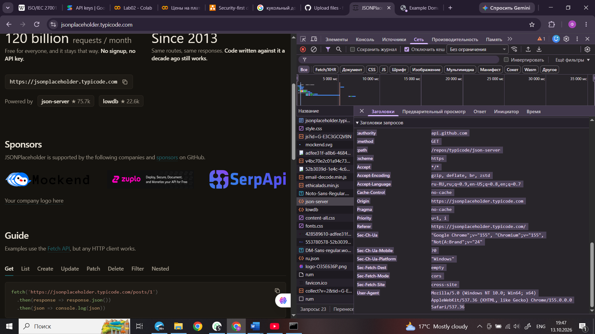

Лабораторная работа №2. Исследование HTTP-запросов и ответов

Студент: Имя Фамилия
Дата: 13.10.2026

Задание A. Адреса, DNS и URL

A1–A3. DNS

С помощью "nslookup" проверены домены "example.com", "google.com" и "github.com".

Для "example.com" получены IPv4-адреса "104.20.23.154" и "172.66.147.243". Для "github.com" получен адрес "140.82.121.4".

DNS преобразует доменное имя в IP-адрес, необходимый для соединения с сервером.

A4. Разбор URL

URL: "https://example.com:443/catalog/item?id=15#details"

- Схема: "https".
- Хост: "example.com".
- Порт: "443".
- Путь: "/catalog/item".
- Параметр запроса: "id=15".
- Фрагмент: "details".

Фрагмент после "#" используется браузером и не отправляется серверу в HTTP-запросе.

A5. Ping

"ping -n 4 google.com": получено 4 пакета из 4, потерь 0%, среднее время 125 мс.

"ping -n 4 github.com": получено 4 пакета из 4, потерь 0%, среднее время 121 мс.

A6. Tracert

Маршрут до Google завершился на 13-м переходе, до GitHub — на 15-м. Некоторые промежуточные узлы не ответили. Это может быть связано с фильтрацией диагностических запросов и не обязательно означает неисправность маршрута.

Задание B. Анализ запросов в DevTools

В Network наблюдались запросы типов Document, Stylesheet, Script, Fetch/XHR, Font и Image. Были замечены ответы со статусами 200, 204, 302 и 304.

Исследованный запрос: "https://api.github.com/repos/typicode/json-server".

- Метод: GET.
- Статус: 200 OK, при первой проверке — загрузка из дискового кэша.
- Content-Type: "application/json; charset=utf-8".
- Cache-Control: "public, max-age=60, s-maxage=60".
- Content-Encoding: "gzip".
- В ответе присутствовали ETag и Last-Modified.

После отключения кэша и обновления страницы сервер вернул 200 OK. В запросе присутствовали Cache-Control: no-cache и Pragma: no-cache. Заголовки If-None-Match и If-Modified-Since в зафиксированном запросе не наблюдались.

Таблица запросов

Заполни три строки по фактическим данным в DevTools. Размер и время нужно переписать со своего скриншота.

Запрос| Метод| Статус| Тип| Content-Type| Кэш| Размер| Время
api.github.com/repos/typicode/json-server| GET| 200| Fetch/XHR — проверить| application/json; charset=utf-8| max-age=60| По DevTools| По DevTools
Document| По DevTools| По DevTools| Document| По DevTools| По DevTools| По DevTools| По DevTools
Script или Image| По DevTools| По DevTools| Script/Image| По DevTools| По DevTools| По DevTools| По DevTools

Скриншот: ""

Задание C. Методы и статус-коды

Эксперимент| Результат| Объяснение
GET "/posts/1"| 200 OK| Пост успешно получен.
GET "/posts?userId=1"| 200 OK| Получен список постов пользователя.
GET "/posts/9999"| 404 Not Found| Ресурс не найден.
POST "/posts"| 201 Created| Создан новый объект.
PUT "/posts/1"| 200 OK| Возвращены переданные данные ресурса.
PATCH "/posts/1"| 200 OK| Изменено указанное поле.
DELETE "/posts/1"| 200 OK| Сервер подтвердил удаление.
GET "/redirect/1"| 302 FOUND| Сервер перенаправил запрос.
GET "/redirect/1" с "-L"| 302, затем 200| curl перешёл по перенаправлению.
GET "/status/418"| 418 I'M A TEAPOT| Сервер вернул указанный статус.
GET "/status/500"| 500 INTERNAL SERVER ERROR| Ошибка на стороне сервера.

PUT обычно заменяет ресурс целиком, а PATCH изменяет только выбранные поля.

401 означает, что пользователь не прошёл аутентификацию. 403 означает, что сервер отказывает в доступе из-за недостатка прав.

POST обычно не идемпотентен: повторная отправка может создать несколько ресурсов. В JSONPlaceholder изменения имитируются и не сохраняются как в настоящей базе данных.

Задание D. Заголовки и cookies

Команда "curl.exe -i https://httpbin.org/cookies/set/lab2/test123" вернула 302 FOUND и заголовок "Set-Cookie: lab2=test123; Path=/".

При использовании "curl.exe -i -L -c cookies.txt -b cookies.txt https://httpbin.org/cookies/set/lab2/test123" получен ответ 200 OK с JSON:

"{"cookies":{"lab2":"test123"}}"

Это показывает, что cookie сохраняется и отправляется при следующем запросе.

Атрибут| Значение
Path| Определяет пути сайта, для которых отправляется cookie.
HttpOnly| Запрещает доступ к cookie из JavaScript.
Secure| Cookie отправляется только по HTTPS.
SameSite| Ограничивает отправку cookie в межсайтовых запросах.
Max-Age| Указывает срок жизни в секундах.

В фактическом ответе httpbin наблюдались "lab2=test123" и "Path=/". Остальные атрибуты разобраны по учебному примеру F1.

Задание E. HTTPS и кэширование

E1. HTTPS-запрос

Команда "curl.exe -I https://example.com" вернула 200 OK. В заголовках наблюдались Content-Type, Last-Modified, Age и CF-Cache-Status: HIT.

HEAD возвращает заголовки ответа без тела ресурса.

E2. Подробное соединение

Команда "curl.exe -vI https://example.com" показала установление HTTPS-соединения с портом 443 и ответ 200 OK. Поля subject и issuer сертификата в выводе Windows Schannel не отображались.

E3. Сертификат

В браузере для example.com отображалось сообщение «Подключение защищено». Скриншот следует приложить в папку "screenshots/". Издателя и срок действия сертификата указывать только в том случае, если они видны в сведениях о сертификате.

E4. Кэширование

У исследованного запроса присутствовали Cache-Control, ETag и Last-Modified. Один из ответов был загружен из дискового кэша. После отключения кэша был получен свежий ответ 200 OK.

В выполненном эксперименте ответ 304 Not Modified не наблюдался. Следовательно, можно подтвердить наличие кэширования, но не получение статуса 304.

Задание F. Анализ HTTP-сообщений

F1. Разбор запроса и ответа

Метод — POST, путь — "/api/login", версия — HTTP/1.1. Клиент отправляет данные для входа.

Content-Type задаёт формат тела запроса; Accept сообщает желаемый формат ответа; Content-Length указывает заявленный размер тела в байтах.

200 OK означает успешное выполнение. Ответ содержит id пользователя 42 и роль STUDENT.

- HttpOnly — JavaScript не может читать cookie.
- Secure — cookie отправляется только по HTTPS.
- SameSite=Lax — ограничивается отправка в межсайтовых запросах.
- Max-Age=3600 — срок действия один час.

Следующий запрос может выглядеть так:

GET /api/students/42 HTTP/1.1
Host: uni.example
Cookie: session=abc123
Accept: application/json

Заголовок Cookie передаёт идентификатор сессии. Cache-Control: no-store запрещает сохранять ответ в кэше. Пароль необходимо передавать через HTTPS, поскольку HTTP не шифрует данные.

F2. Подбор статус-кодов

№| Код| Обоснование
1| 200 OK| Профиль получен.
2| 201 Created| Создан студент.
3| 204 No Content| Удаление без тела ответа.
4| 301 Moved Permanently| Адрес перенесён навсегда.
5| 400 Bad Request| Некорректный JSON.
6| 401 Unauthorized| Нет аутентификации.
7| 403 Forbidden| Нет необходимых прав.
8| 404 Not Found| Студент не найден.
9| 409 Conflict| Email уже зарегистрирован.
10| 422 Unprocessable Content| Значение оценки не проходит проверку.
11| 429 Too Many Requests| Превышен лимит запросов.
12| 500 Internal Server Error| Необработанное исключение.
13| 502 Bad Gateway| Reverse proxy не получил корректный ответ backend.
14| 304 Not Modified| Ресурс не изменился.

F3. Написание запросов

Получить студента:

GET /api/students/42 HTTP/1.1
Host: uni.example
Accept: application/json

Создать студента:

POST /api/students HTTP/1.1
Host: uni.example
Content-Type: application/json
Accept: application/json

{"firstName":"Anna","lastName":"Ivanova","group":"IS-21"}

Полностью заменить данные:

PUT /api/students/42 HTTP/1.1
Host: uni.example
Content-Type: application/json
Accept: application/json

{"id":42,"firstName":"Anna","lastName":"Ivanova","group":"IS-21"}

Изменить только группу:

PATCH /api/students/42 HTTP/1.1
Host: uni.example
Content-Type: application/json
Accept: application/json

{"group":"IS-22"}

Удалить студента:

DELETE /api/students/42 HTTP/1.1
Host: uni.example
Accept: application/json

Получить вторую страницу группы IS-21 по 20 записей:

GET /api/students?group=IS-21&page=2&limit=20 HTTP/1.1
Host: uni.example
Accept: application/json

Схема JSON приведена как пример, поскольку точная схема API в условии не определена.

F4. Диагностика

№| Стадия и первая проверка
1| DNS: проверить домен и выполнить nslookup.
2| Сервер/сеть: проверить, запущено ли приложение на порту 3000.
3| Аутентификация: проверить отсутствие Authorization и наличие токена.
4| Маршрутизация: исправить путь на "/api/students/42".
5| Frontend: проверить структуру JSON; при указанной структуре использовать "response.data".
6| Backend: изучить stack trace и обращение к undefined.
7| Браузер/CORS: изучить сообщение консоли и настройки CORS сервера.

F5. Повторная отправка POST

После обрыва соединения клиент не знает, успел ли сервер создать заказ. Повторный запрос может создать дубликат или привести к повторному списанию денег. Если не повторять запрос, заказ может остаться несозданным.

Решение — уникальный ключ идемпотентности, например "Idempotency-Key". Сервер сохраняет результат операции и при повторе с тем же ключом не создаёт заказ заново. Также клиент может проверить состояние заказа отдельным запросом.

Выводы

В лабораторной работе изучены DNS, URL, HTTP-методы, статус-коды, заголовки и cookies. С помощью curl проверены успешные запросы, ошибки и перенаправления. В DevTools исследованы сетевые запросы и кэширование. Также рассмотрены диагностика ошибок и безопасная обработка повторных запросов.
